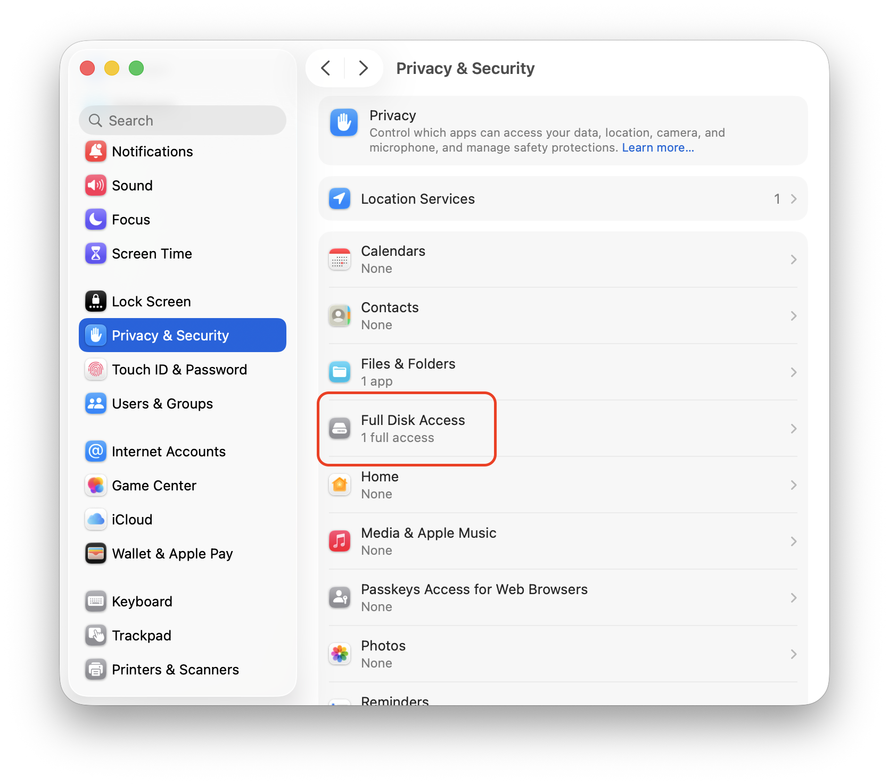
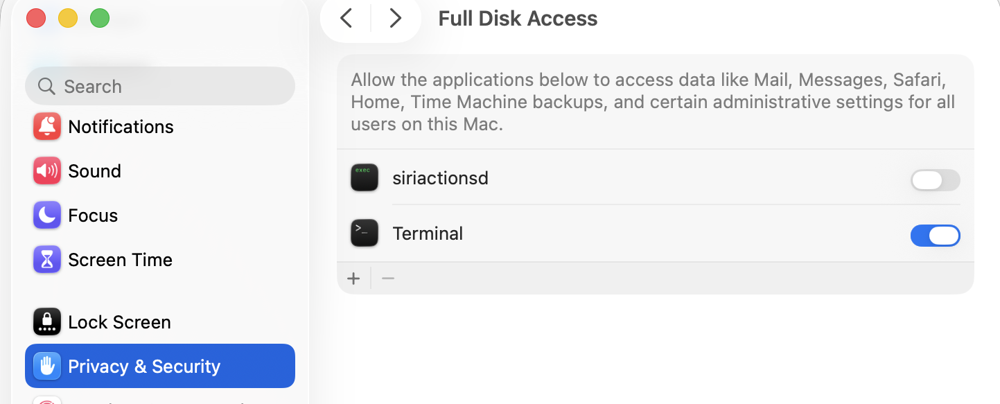

# How to Grant Full Disk Access on macOS

This guide explains how to grant Full Disk Access to the terminal application running `apple-message-forensics`. On macOS, privacy protections (TCC) block access to `~/Library/Messages` and `~/Library/Application Support/AddressBook`, even when commands are run with `sudo`.

## Prerequisites

- Administrative access to the macOS machine.
- The terminal application you intend to use (for example, Terminal, iTerm2, or VS Code terminal).

## Procedure

1. Open **System Settings**.
2. Navigate to **Privacy & Security** → **Full Disk Access**.

   

3. Locate your terminal application in the list (for example, **Terminal** or **iTerm**).
4. Toggle the switch next to the application to **On**.

   

5. If prompted, enter your administrator password or use Touch ID.
6. When prompted that the application needs to quit to apply settings, select **Quit & Reopen** (or restart the application manually).

## Verification

To verify that Full Disk Access is active, run:

```bash
ls ~/Library/Messages/chat.db
```

If the command prints the path without an `Operation not permitted` error, access has been granted successfully.
